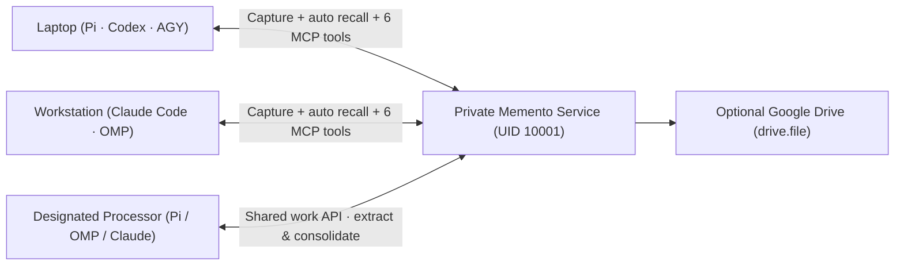
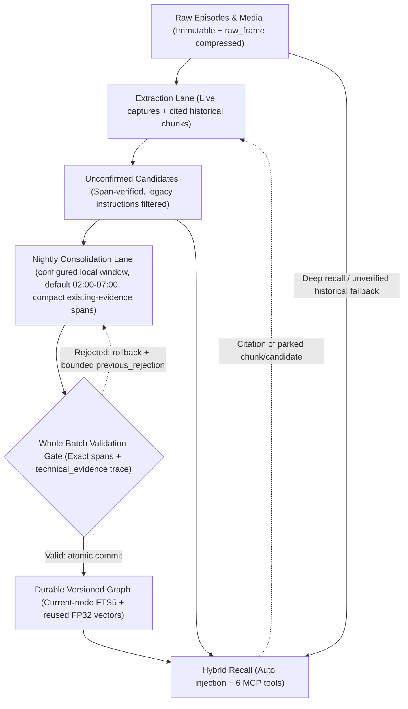

# Memento

### Shared memory for the agents you already use.

A decision you explain to Pi on your laptop can help Claude Code on another computer. A useful lesson from one session can help the next agent choose its approach.

Memento gives **one owner's agents a shared, private memory** across Pi, OMP, Claude Code, Codex and Antigravity (`agy`). It connects useful facts, lessons and unfinished obligations to their original conversations, helping you spend less time repeating context when you change sessions, agents or devices.

**Memories keep their original evidence, and corrections keep their history.**

Keep using your native agents. There is no new chat app, and processing uses your existing native CLI login and model rather than requiring another model API key.

[Product website](https://memento.bezosapp.uk/) · [Privacy](https://memento.bezosapp.uk/privacy/) · [Terms](https://memento.bezosapp.uk/terms/)

## What carries forward

| What it does | How it works | Why it helps |
| --- | --- | --- |
| **Shares context across agents and devices** | Connected clients contribute their conversations to one private service and recall from the same memory. | A decision made with one agent can inform work with another, without repeating the whole story. |
| **Offers relevant context automatically** | The service selects relevant facts, behavioral suggestions and at most one matching media reference for native integrations to offer with the current request, within a small context budget. Explicit recall is also available. | Your agent can pick up useful context without you remembering to search for it. |
| **Keeps memories checkable** | Memories retain exact source quotes, conversation references and dates. Corrections preserve earlier versions and reasons. | You can inspect where a claim came from and how it changed. |
| **Carries useful lessons forward** | Scheduled consolidation can turn supported experiences into conditional suggestions. Later evidence and corrections can refine them. | Another session can benefit from what worked before, with conditions and exceptions attached. |
| **Tracks unfinished obligations** | Open-loop markers retain pending commitments and waits on other people; newer evidence can establish completion or cancellation. | Ask what is still open across conversations, with the evidence available to check. |
| **Keeps capture queued during outages** | Conversations remain in a durable local queue until a later native activity or explicit upload retries them. | A temporary memory-host outage does not require you to stop chatting or re-import queued history. |
| **Brings selected history into memory** | Import native histories on their original devices, including supported attachments, then process them through the same memory path. | Useful decisions and experiences from before installation can become available to your agents. |
| **Finds files shared in conversations** | Supported captured attachments are indexed locally once their bytes and conversation references arrive. Search results retain the original file link and source. | Find an image, recording or document by relevant content instead of remembering its filename. |
| **Offers optional Google Drive storage** | A dedicated app-accessible folder holds eligible artifacts and manual backups; Memento does not index your whole Drive. | Keep older files available and create requested recovery snapshots while retaining a local memory database. |
| **Keeps the owner in control** | You host the private service, choose its connected agents and processor, and control owner-only review, forgetting and export. | You can inspect, correct and move your memory instead of leaving it tied to one chat session. |

For example, “I still owe Mira the release checklist” can become an open loop. A decision such as “Tuesday is the release date; Friday is the fallback” can be recalled with its exact quote. A lesson might be: “When a file search returns nothing, check whether the intended directory was in scope before repeating the query.” That advice needs supporting experience and keeps its conditions and exceptions.

**Learned suggestions are context, not standing instructions.** They come from supported experiences or stated preferences; they do not replace `AGENTS.md`, install skills or grant permission to act. Your current instructions and repository rules stay authoritative. Recall and inference can miss relevant context or be wrong, so evidence remains available to inspect and explicit recall is available when automatic context is insufficient.

## One owner, several agents, shared context




Each device contributes its own conversations and can retrieve relevant memories from the same service. This shares context across your agents; each native conversation and device keeps its own identity.

## How it fits together

The automatic learning path keeps original conversations separate from inferred memory, validates every quote and technical trace before committing, and reuses derived vectors and current-node keyword indexes:




| Stage | How it works in the current architecture |
| --- | --- |
| **Agent-owned processing** | Pi uses one persistent native process with only the Memento work tool. The agent discovers the eligible pool, chooses related batches and submits validated updates through the existing API. OMP/Claude retain the two-lane headless runner. |
| **Optional historical pool & on-demand promotion** | A one-time owner cutover (`memento-admin --data-dir /data history park`) parks the remaining historical backlog and pending candidates in place without deleting history or falsifying extraction cursors, while all subsequent captures continue full extraction and consolidation. When no current fact or lesson matches an unscoped query, recall can surface bounded unverified historical context; citing a parked chunk or candidate promotes it into the normal extraction/consolidation pipeline on demand. |
| **Compact consolidation context** | Existing graph nodes and relations supply their exact stored quotes, character spans and native trace metadata without repeating surrounding `±400`-character raw windows (`~49%` smaller consolidation payloads). |
| **Self-correcting validation feedback** | Every batch is validated atomically. If a batch fails a quote, span, coverage or grounding check, nothing commits; the job records a bounded private `previous_rejection` (fixed code + up to 3 offending quote references) so the next retry can fix the exact error instead of repeating it blind. |
| **Dual-path behavioral & technical learning** | User-stated rules (`authority="explicit_user"`) require direct user ground-truth quotes. Inferred technical lessons (`authority="inferred"`) require captured native `attempt → result` sequences in one conversation (`technical_evidence`), even when the lesson was first articulated in a later reporting tool call, and retain evidenced pitfalls to avoid when refining earlier approaches. |
| **Legacy instruction filtering** | Historical candidates whose only evidence is a legacy developer/instruction envelope stay preserved and searchable in history, but are excluded from consolidation model calls (`excluded_legacy_candidates`). |
| **Zero-bloat FTS & vector reuse** | `node_fts` indexes only the latest version of each node identity via a `VACUUM`-safe integer key mapping (`node_fts_documents`), and corroborating or pinning unchanged text (`attach` / `pin`) reuses the existing FP32 vector in place; the native Qdrant Edge indexes are derived from SQLite authority. |
| **Non-blocking health checks** | `/health` probes SQLite writer availability on a dedicated short-lived connection (`0.25s` bound) and reads indexing failures from a `WAL` snapshot, never queuing behind read-only context preparation. |

Extraction starts after native compaction or conversation inactivity. Candidates remain visibly unconfirmed and can be recalled before promotion; deeper consolidation runs in the configured night window. Learning takes processing time.

Relevant facts, eligible behavioral suggestions and at most one matching media reference can appear automatically in later prompts, within a small shared context budget. They are labeled distinctly, and the result can legitimately be empty. A file match points to the original; it does not imply that facts or lessons were extracted from the image or recording. The six memory tools (`recall`, `remember`, `link`, `supersede`, `history`, `loop`) let an agent explicitly recall, save, connect, correct or inspect memories and manage loop markers.

History retains exact source quotes, dates and changes. **Old conversations keep their original dates:** age affects recall ranking, without deleting memories or making imported history appear new. Age alone never closes a task. Reminder dates can be stored and listed; there is no proactive reminder delivery.

## Bring your history, keep your data

Import selected native histories on their original devices, including supported attachments, and check capture, upload and processing progress separately. If the memory host goes offline while you keep chatting on a laptop, those conversations stay queued on the laptop. When the host returns and you resume chatting, native activity automatically retries the queued history; an explicit upload can retry it too. An idle client has no background retry daemon. Explicit saves report failure rather than pretending to have succeeded and are not queued as mutations.

The private service stores memory on local Linux storage and runs embeddings locally. Extraction and consolidation use the designated native agent's model provider, consume its usage and can send conversation content to that provider. Local storage does not mean entirely local model processing.

Google Drive is optional. It uses a dedicated app-accessible folder for artifacts and manual backups, with explicit human consent to `drive.file`. Drive copies and exported archives are plaintext. A migration export carries the database and files that exist only locally; files already on Drive stay there, with their references preserved. You can move the service without downloading and repacking those files. The owner's forget action removes active memory and suppresses re-extraction; raw history and existing backups remain.

## Start with your agent

First, an operator sets up **one private service** and **one processing host** using Pi, OMP or Claude Code. Codex and Antigravity (`agy`) can connect as capture/recall clients; neither is supported as the server processor. The setup reference below covers host prerequisites, storage and permissions.

Once that host is ready, give each agent your instance's guide:

> Connect this agent to Memento using `https://YOUR_MACHINE.YOUR_TAILNET.ts.net/connect`.

The agent fetches the guide, installs its native integration and verifies the connection using the existing native login. Native trust/MCP permissions and Google consent remain explicit human steps. Start a fresh native session after installation.

The guide lives on your private service. A headless agent can fetch it through its local shell or HTTP client on the device with access to that service; a public web-browsing service may not reach it. On the service host itself, the loopback guide is `http://127.0.0.1:8765/connect`.

## Setup and reference

The expandable sections retain the full installation, agent and operator instructions.

<details>
<summary><strong>Set up the private service and connect your agents</strong></summary>

## Installation map

1. Run **one persistent service** on local Linux storage.
2. Set up **one server processor** using Pi, OMP or Claude Code with an existing native login.
3. Set up other harnesses/devices as **capture clients**.
4. Start new native sessions and verify capture → candidate → fresh-session recall.
5. If wanted, connect Google Drive through explicit human consent and verify activation.

> **Already installed?** Native schema-header-5 installations reuse their existing data directory or volume, Compose overrides, private configs and native logins. Python schema-header-1/2/3 installations must follow the offline import below before starting the native service; pointing it at the old database is refused. Re-running client setup preserves the generated identity. Do not initialize a fresh database over an existing deployment, copy identities between devices, or use `docker compose down -v` as an upgrade command.
>
> **Installing agent?** Execute the permitted setup and verification yourself. Surface only genuine human steps: native login/trust, service-owner permissions and Google consent. Never request secret values in chat or treat a healthy API as proof of native capture or Drive authorization.

## 1. Run the service

### Requirements

- Linux **x86_64** with Docker Engine and Compose for the native service. Python **3.12+** is needed on hosts running the portable native-agent runner/processor. The Python service remains available separately for comparison/development below.
- Dedicated persistent **local Linux storage**. Do not use NFS, SMB or FUSE for the live database.
- Space and network access for the pinned full `google/embeddinggemma-2` model; any required model access/license acceptance is a human prerequisite.
- A separate ordinary-user native agent account. One service process per data directory.

### Recommended: Docker Compose

Compose builds `Dockerfile.native`: the Rust service and native owner/import tools, with pinned ONNX Runtime and media libraries. The baseline Python `Dockerfile` and `pyproject.toml` remain available for comparison/development; Compose does not select them.

Clone the repository, then enter it:

```sh
git clone https://github.com/misunders2d/memento.git
cd memento
```

For a **fresh installation only**, the human/operator prepares the default bind mount with the service's ownership. These are operator commands, not permission for an agent to acquire sudo or Docker-daemon access:

```sh
sudo install -d -o 10001 -g 10001 -m 0700 ./data
docker compose up --build -d
curl --fail http://127.0.0.1:8765/health
```

Wait for healthy real-model startup; the first download can take time. Inspect `docker compose logs memory` if startup fails. Model cache persists under `/data/models`. **Do not disable embeddings to declare installation successful.**

Text stays literal even when it contains model control-token spellings; real image and audio inputs still use the native multimodal processor. On the first upgrade, Memento re-encodes only previously indexed text containing those spellings, preserving raw history, vector IDs and ordinary text/media vectors. Failed text units become due again, but remain failures until the normal indexer actually encodes them successfully.

Default deployment properties:

| Setting | Default |
| --- | --- |
| Published listener | `127.0.0.1:8765` only |
| Persistent data | `./data` → `/data` |
| Service UID/GID | `10001:10001` |
| Agent UID used for separation checks | `1000`; set the actual agent UID if different |
| Limits | 2 CPUs, 5 GiB RAM, 256 PIDs |
| Hardening | Read-only root, `/tmp` tmpfs, all capabilities dropped, no new privileges |
| Restart policy | `unless-stopped` |

Overrides: `MEMENTO_UID`, `MEMENTO_GID`, `MEMENTO_AGENT_UID`, `MEMENTO_DATA_DIR`, `MEMENTO_PORT`, `MEMENTO_CPUS`, `MEMENTO_MEMORY`, `MEMENTO_MEMORY_SWAP`; optional `.env` or `MEMENTO_ENV_FILE`. Preserve existing values and mount configuration during upgrades. Enable Docker startup on the host according to its normal administration policy.

Resource defaults remain 2 CPUs and 5 GiB RAM. `MEMENTO_CPUS` sets the CPU allowance; use the host's logical CPU count to allow all its CPUs. `MEMENTO_MEMORY` sets the RAM ceiling. `MEMENTO_MEMORY_SWAP` is the combined RAM-plus-swap ceiling (default 10 GiB, allowing 5 GiB swap); keep it at least as large as the RAM ceiling, or equal to it to disable container swap. Choose limits that leave room for the host and other applications. These Compose settings apply when creating/recreating the container; changing `.env` alone does not update a running container.

**Human-review isolation matters:** the agent must not share the service UID, have sudo, or control the Docker daemon. Docker-daemon access can defeat this boundary. Container hardening is not a substitute for separating those privileges.

### Upgrade a Python instance to the native service

These are explicit service-owner operations, not automatic startup migration. Stop the old service and its processing timer before taking the final checkpointed offline copy. Preserve that original directory, private client configs and identities; remote clients can retain new captures in their existing outboxes while the service is stopped. Never run the old and new instances as simultaneous writers.

The offline source copy must include `memory.sqlite`, all registered local payloads under `blobs/`, and its original `drive-binding.json` when remote references exist. A database with a nonempty WAL is refused: make a consistent, checkpointed copy with the old service's supported backup tooling, rather than copying a live database or deleting its sidecars. The importer reads this source only, verifies authority rows and FP32 IDs/bytes, and publishes schema header 5 into a **new, nonexistent child directory**. Missing required local payloads, missing remote binding or unknown headers abort import.

For example, with a complete stopped copy at `/private/legacy-checkpoint`, prepare a separate empty parent owned by the selected service UID/GID (defaults shown), then build without starting the service:

```sh
sudo install -d -o 10001 -g 10001 -m 0700 /private/native-import
docker compose build memory
docker compose run --rm --no-deps \
  --entrypoint /usr/local/bin/memento-import \
  -v /private/legacy-checkpoint:/legacy:ro \
  -v /private/native-import:/data \
  memory /legacy/memory.sqlite /data/instance
```

Use the configured UID/GID if overridden. The `/data` override above is the new import parent, not the old live data mount. Require the import receipt to report `complete: true`; preserve that receipt and the original source. Only after successful verification, point `MEMENTO_DATA_DIR` (or the existing Compose mount override) at `/private/native-import/instance`, retain all other overrides, and verify that the effective `/data` mount selects this imported destination before `docker compose up --build -d`. Reconnect the original Drive binding through the normal owner-consent workflow if needed; import does not copy OAuth tokens. The native service obtains its pinned model assets in the destination's own model cache. Do not change database headers by hand or point a Python service at the imported header-5 database. Rollback retains the untouched old instance; do not accept writes on both timelines.

SQLite retains the original vectors and all memory authority. The native service loads Qdrant Edge in process; its private `data/search/` index is disposable and excluded from portable/Drive database snapshots. Initial construction and recovery rebuild it from existing vectors without re-embedding. Capture and health remain available while search prepares; `/health` reports `search_ready: false`, and semantic recall returns an explicit 503 until ready. Keep space for the derived index and SQLite WAL while the initial read snapshot is open.

### Python comparison/development only

The baseline Python entrypoints remain explicit development/comparison tools. Use a separate Python-format data directory, never the native service's header-5 storage:

```sh
uv sync --extra media --extra embedding --extra drive
MEMENTO_EMBEDDINGS=1 uv run memento --data-dir ./python-development-data
```

Run under the intended service identity with private storage, not inside the ordinary agent's identity when testing human-review isolation. This foreground command does not install the native service, a boot service or Compose's resource limits. To build the Python comparison image explicitly, use `docker build -f Dockerfile -t memento-python-development .`.

The Python image includes its pinned Linux x86_64 Qdrant executable and starts it as a private loopback child in the same CPU/RAM limits. Python development can select that executable with `MEMENTO_QDRANT_BINARY=/absolute/path/to/qdrant`; it accepts no remote search endpoint. Without this setting, Python development retains its SQLite exact engine. A configured missing or failed child never falls back to that engine.

API contracts: `http://127.0.0.1:8765/docs`. Agent-readable installation guide: `http://127.0.0.1:8765/connect`.

## 2. Install the native server processor

Use the **ordinary host agent user**, never root or the service UID. Install your chosen native CLI and complete its normal login first. Memento uses that CLI's own default model/login.

Download the stdlib-only runner from your trusted private service:

```sh
URL=http://127.0.0.1:8765
install -d -m 0700 "$HOME/.local/share/memento"
curl --fail "$URL/runner" -o "$HOME/.local/share/memento/runner.py"
chmod 600 "$HOME/.local/share/memento/runner.py"
python3 "$HOME/.local/share/memento/runner.py" setup \
  --agent pi --timezone Europe/Berlin --url "$URL"
```

Replace the timezone with the actual **IANA timezone**. Choose `--agent pi`, `omp` or `claude` for the single server processor. Setup is prompt-free; it installs the native capture/recall hooks or extensions, MCP definitions, private `runner.json` and sibling `bridge.py`, plus the processing service/timer. It does not log into a model provider or authorize Google Drive.

Default config: `${XDG_CONFIG_HOME:-$HOME/.config}/memento/runner.json`. Use `--config PATH` consistently when choosing another location. `--no-activate` installs without starting the timer.

Consolidation runs in a per-installation **local-time window** of the configured timezone, start inclusive and end exclusive. The default is 02:00–07:00. Set another with both `--consolidation-start HH:MM --consolidation-end HH:MM`; minutes are honored and the window may cross midnight, in which case the night is named after the date it started. Rerunning setup without the flags keeps the stored window. Clients take no schedule; the server runner sends its window with every claim, and the service rejects an invalid or empty one before doing any work.

The user timer starts roughly two minutes after boot and then **15 minutes after each completed run**. For unattended processing after logout, the human/operator enables lingering:

```sh
sudo loginctl enable-linger YOUR_AGENT_USER
```

Keep one server processing config/timer. Do not silently convert it into a client when installing another harness. A sleeping or powered-off host cannot process memory; keep it awake for an overnight acceptance check.

With the OMP/Claude legacy runner, a failed processing job can be retried after a 15-minute wait following its batch, while other work continues. A rejected consolidation batch stays pending, unchanged, for that retry while other ready candidates consolidate in separate batches; at most one consolidation runs at a time, and one extraction can run alongside it. The faster of the two lanes claims its next job as soon as it finishes instead of waiting for the slower one, within the same two-process limit; update the service before the designated processing runner, while other capture/recall clients need no update. When the service rejected the batch for an exact validation reason, the retry receives that fixed reason and the offending reference privately with its input, so the next attempt can fix it instead of repeating it blind; nothing from a rejected attempt is committed. A run still exits nonzero if any attempt failed, even if a later retry succeeded.

Failed attempts write a JSON diagnostic to stderr, visible in `journalctl --user -u memento-runner.service`: job ID, work kind, error category and, when available, HTTP status with an allowlisted Memento rejection code or a safe failure cause. Diagnostics exclude memory text, model output, URLs and arbitrary server error messages.

Generic `service_rejected` or HTTP 422 is not a diagnosis. Identify the exact safe rejection reason and verify an affected retry before declaring the worker recovered; successful unrelated batches do not establish that a reported failure is fixed.

In the legacy runner, requesting the next batch allows up to 60 seconds, because the server prepares the batch context before answering; renewals, completions, releases and foreground commands keep their 15-second bound. If that request fails, the run still exits with the generic `service_rejected` message, preceded by a `stage: claim` diagnostic with the same safe status or cause classification. The run does not retry the request; the next timer run claims again.

### Shared processing API and the Pi worker

The service never calls a model. The designated local agent uses its existing native login/model and the common **`POST /work`** or MCP **`work`** contract. Pi, Claude, Codex, OMP and AGY can use this API; API compatibility does not qualify an unattended native launcher. Automatic Pi processing uses the persistent worker below, OMP/Claude retain the headless runner, and automatic Codex/AGY processing remains refused under the documented isolation limits.

The `work` tool supports `pool`, `claim`, `read`, `renew`, `complete`, `submit`, `release` and `status`. Paginated pool metadata exposes all eligible extraction conversations, consolidation candidates and existing-memory maintenance groups, with parked/deferred work counted separately. Claims supply bounded evidence and the existing exact output schemas; only the service validates and commits. Full processing includes facts, entities, meaningful relations, loop closure/responsibility, supported experiences and behavioral suggestions, plus existing-memory reconciliation. Protected choices and chronology still apply.

Pi keeps one native process alive across work units, using only its `memento_work` adapter to this same API. The host verifies the complete effective tool catalog before the first model prompt, renews leases independently, fixes actor/schedule/lease capabilities and releases unfinished work on cancellation. Static task policies are supplied once per bounded session. Model context retains current evidence, a compact receipt and which work kinds were empty; completed source text is removed. After eight commits the host starts a fresh session in that same process. No new service, database, model account or dependency is required. This path was qualified with Pi 1.4.0.

The agent can select consolidation batches of **1–128** related candidates (Pi starts at 64; legacy default 16), reduce a batch when needed and commit/request fresh work together with `submit`. Overlapping source windows from the same episode and authority are combined without adding uncited gaps or changing raw history. Continuous claims admit new eligible candidates within the configured night window; compaction/inactivity, parking and deferrals remain enforced. Only one consolidation lease runs at a time. Reducing an oversized uncommitted batch retains its original job payload while making untouched candidates available to smaller batches; live or already committed work is never repartitioned.

HTTP returns complete packets. MCP returns compact claim descriptors because native clients can truncate large tool results. Use `read` with the supplied job/owner and character cursor to concatenate every evidence page; read/cache each kind's policy and schema separately using `read` with `policy`. Never treat a descriptor or partial page as complete evidence. Renew leases outside model generation every `lease_seconds / 4`. After an uncertain completion, inspect `status` before retrying the identical result. A rejected plan commits nothing and retains the existing bounded validation feedback.

Update the service **before** the processing runner. The version-1 client release keeps its original five client assets and supplies two optional processor assets, `worker.py` and `native_worker.ts`; the normal `memento agent update pi` installs them with hash validation. The standalone runner can also fetch missing processor assets from that same release. Other capture/recall clients need no update for processing. The normal timer/window is unchanged; the host must stay awake. Completion means the currently eligible pool was exhausted, not that parked history or unresolved obligations were completed.

### Codex limitation

Codex capture/import/recall/MCP client integration is available after **human `/hooks` trust and MCP permissions**. Setup never grants those permissions. Codex **server extraction is fail-closed**: the tested native CLI still exposed tool routing under its read-only/approval flags, so it did not meet tools-zero processing requirements. Use Pi, OMP or Claude Code as the processor; do not bypass a native refusal or claim Codex extraction acceptance.

Antigravity (`agy`) remains a production capture/recall client. Server processing stays refused: synthetic qualification executed native task-list access despite empty tools and excluded default components, so tools-zero isolation is unverified. Native headless calls also retain task/output transcripts as explicit-user history; do not import those processing sessions as human evidence. Qualification rejected that tool activity; no AGY server processing adapter or automatic quota fallback is enabled.

## 3. Add other harnesses or devices as clients

A client captures conversations, retrieves relevant context automatically and nudges the server after compaction. It does **not** discover a processing model, generate memories or install another processing timer.

Expose the downloaded stdlib runner as a command once on each device:

```sh
URL=https://YOUR_MACHINE.YOUR_TAILNET.ts.net
install -d -m 0700 "$HOME/.local/share/memento"
mkdir -p "$HOME/.local/bin"
curl --fail "$URL/runner" -o "$HOME/.local/share/memento/runner.py"
chmod 700 "$HOME/.local/share/memento/runner.py"
ln -s "$HOME/.local/share/memento/runner.py" "$HOME/.local/bin/memento"
```

Create the symlink only when that command path is unused; reuse an existing link to this runner, and never overwrite another program. The link and the processing timer use the same runner file. If `~/.local/bin` is not on `PATH`, use its full path. An installed Python package also supports `memento agent add`.

Then connect the **selected** harness:

```sh
memento agent add claude
```

Choose `pi`, `omp`, `claude`, `codex` or `agy`. The existing harness config or default `runner.json` supplies the URL; otherwise pass `--url https://YOUR_MACHINE.YOUR_TAILNET.ts.net`. A matching default `runner.json` retains its server/client role and identity; otherwise the config is `${XDG_CONFIG_HOME:-$HOME/.config}/memento/HARNESS/runner.json`. Use `--config PATH` for an existing custom location. Repeating the command reinstalls only that harness and preserves its identity and processing role.

| Harness | Installed integration |
| --- | --- |
| Pi / OMP | Native extension for capture, automatic context and six memory tools |
| Claude Code | Native capture/recall/compaction hooks and Memento MCP definition |
| Codex | Native hooks and MCP definition; human `/hooks` trust and MCP permissions still required |
| Antigravity (`agy`) | A `memento` named hook in `~/.gemini/config/hooks.json` (session provenance, per-turn automatic context, transcript capture, save provenance checks) and `mcp_config.json` server entry; other named hooks are untouched. Client only: it cannot be the server processor |

This command reuses the shipped native installer and does not add a daemon or restart active agents. Without the command link, `python3 ~/.local/share/memento/runner.py agent add HARNESS --url "$URL"` is equivalent. Keep each device's own config and stable generated `client_uid`; do not copy configs or histories to pretend they came from another origin.

**Start new native sessions after installation.** Do not silently restart an active user-owned agent. The existing native profile, model selection and login remain the source of truth.

### Explicit client updates and offline operation

```sh
memento agent update claude
```

Choose the installed harness and reuse any custom `--config` and `--native-config-dir`. The command pulls a validated code bundle from the **existing configured service**, preserves identity, role, queued captures, native settings and timers, and keeps the same standalone runner/command path. It never installs another daemon, checks for updates per message, changes a login or restarts an active session.

Downloads are fully validated before replacing code. Each file is replaced atomically, with the standalone runner last; this is **not a whole-installation transaction**. If interrupted during replacement, rerun the command when connected to complete it. Use native reload or a fresh session to load new code. If a release changes hook or MCP definitions, rerun `memento agent add HARNESS`; native trust remains a human decision.

Codex's additional async recall hook requires `memento agent add codex` with the same installation options after updating, then human review in `/hooks`. Updating files alone does not install or trust that definition. Pi/OMP need an extension reload or fresh session for same-turn late delivery.

If the service is unavailable, capture remains in the client's durable outbox and retries on a later native lifecycle hook or explicit `bridge.py upload`. An idle client has no retry daemon. Automatic recall waits up to three seconds; the same request can finish within a fifteen-second background limit. A fresh nonempty result for the current query takes priority; an older delayed result is fallback only while the current query is pending or healthy-empty, with its original-query label. Pi/OMP can receive it before the next model request in the same turn; their local claim uses a cooperative 200-millisecond deadline with a one-second process backstop, retaining an expired claim for a later boundary. Codex needs native async-hook support and human trust. Otherwise it is offered once at the next human turn, labeled for its original request. Claude/AGY retain next-human delivery. Recall cannot interrupt a running model request or force a continuation. Pending recall is not an outage. A terminal failure warns; a same-query cache up to five minutes old may be used with that warning. Explicit memory saves fail instead of pretending to succeed and are not queued as mutations. Retry an identical uncertain command with its original command ID.


### Private access from another machine

Never expose this unauthenticated HTTP/MCP service publicly. On the server, set the actual tailnet hostname in `.env`, recreate the memory container to apply that environment, and have the authorized operator publish it through Tailscale Serve:

```sh
# .env: MEMENTO_ALLOWED_HOSTS=YOUR_MACHINE.YOUR_TAILNET.ts.net
docker compose up -d
tailscale serve --bg 8765
```

Tailnet HTTPS must be enabled and ACLs must restrict access to your devices. The API's published listener remains loopback-only. MCP host protection stays enabled; the endpoint is `/mcp/`.

Clients use the canonical `/mcp/` URL. Existing `/mcp` URLs receive a relative HTTP 307 redirect, preserving the request method, query string and private HTTPS origin without trusting forwarded headers.

On a client device, download `/runner` from `https://YOUR_MACHINE.YOUR_TAILNET.ts.net`, then run `memento agent add HARNESS --url https://YOUR_MACHINE.YOUR_TAILNET.ts.net`. No client timezone is needed. Do not disable TLS verification or use a public reverse proxy as a shortcut.

### Memory viewer

Open `/ui/` on the same private origin (for example `https://YOUR_MACHINE.YOUR_TAILNET.ts.net/ui/`) for a read-only graph of current memories, behavioral suggestions, open loops and unprocessed conversations/candidates. It only answers on loopback names or hosts listed in `MEMENTO_ALLOWED_HOSTS`, loads no third-party resources, renders memory text as plain text and never writes. "Show all" draws up to 50,000 memories; above that it reports the count instead.

### Technical architecture and trust boundaries


</details>

<details>
<summary><strong>Verify capture, recall and nightly learning</strong></summary>

## 4. Prove memory actually works

Use synthetic text, not secrets. Installed files, a running timer or a convincing answer alone are not proof.

1. In a real native conversation say a distinctive fact, for example: **“My personal NorthWindow project uses accent code BLUE7294.”**
2. Verify raw capture. Find the episode, then fetch it and check the **exact original text, source, conversation and timestamp**:

   ```sh
   curl --get --data-urlencode 'q=NorthWindow' "$URL/episodes/search"
   curl "$URL/episodes/EPISODE_ID"
   ```

3. Use native compaction, or leave the conversation inactive for **30 minutes**. Compaction records a captured sequence boundary. Server-side compaction can drain immediately; a client nudges the server and the processing timer drains due work. Inspect the actual processing journal, not just the timer state:

   ```sh
   systemctl --user status memento-runner.timer
   journalctl --user -u memento-runner.service
   ```

4. Inspect semantic recall and history. Before promotion, the memory should be visible as an **unconfirmed candidate**, with verbatim quotes and exact source spans. Check the reported/requested model and any known usage in history:

   ```sh
   curl --get --data-urlencode 'q=NorthWindow' "$URL/recall"
   curl "$URL/history/MEMORY_ID"
   ```

5. In a **fresh native session**, ask which accent code you chose for NorthWindow, without including the code or memory ID. Require the correct answer **with its memory citation**, automatically supplied without a memory-tool call. Verify that captured raw user text is still only the original question—not the injected context. Also exercise MCP `recall` and `history` explicitly to inspect the evidence.
6. Verify Pi and OMP independently if installing both. Keep one designated server processor. Do not infer one harness works because another does.

For a one-time first-test promotion outside the night window:

```sh
python3 "$HOME/.local/share/memento/runner.py" \
  --config "${XDG_CONFIG_HOME:-$HOME/.config}/memento/runner.json" tick --consolidate-now
```

That flag bypasses **only the consolidation night window**, not extraction eligibility, and does not change the schedule. It is **not proof of normal in-window execution**.

### Verify the normal overnight schedule

Leave an evidence-backed candidate pending before the window starts in the server config's timezone (02:00 unless you configured `--consolidation-start`). Keep the host awake and the timer enabled. Observe the normal service journal and memory history after the first completed in-window tick, without running a forced tick or modifying the clock.

The window is the whole configured span (**02:00–07:00** by default), not exactly its first minute. The Pi worker's continuous claims include newly eligible candidates during the same window. Legacy OMP/Claude claims freeze that night's eligible-candidate boundary; later candidates wait for another night. Processing duration shifts the next tick. Give pending extraction/consolidation time to finish before calling a miss a failure. There is no daytime catch-up for a missed night window.

</details>

<details>
<summary><strong>Import history, read progress and save files</strong></summary>

## Import existing conversation history

Finish the native first-test sequence **before** importing history. Import on each origin device using that device's private config and stable identity. Select actual local paths explicitly; there is no automatic history discovery.

```sh
memento import-history /path/to/history --agent pi
memento upload --agent pi
memento status --agent pi
```

Use `--agent omp`, `claude`, `codex` or `agy` for other histories. For `agy`, pass its `~/.gemini/antigravity-cli/brain` directory; only each conversation's `transcript_full.jsonl` is imported, not the truncated or chunked copies. A matching default config is reused; otherwise the command selects that harness's config. Keep using `--config PATH` for a custom installation. Directories recurse over `*.jsonl`; only complete JSONL records are queued. Repeating an import with the same origin identity/event content is idempotent. Explicit upload drains until empty or transport failure, reports JSON `pending`/`conflicts` counts and exits nonzero if either remains. Native background upload has a bounded runtime and retries durably. A large attachment on a slow connection may need explicit `memento upload`; its retries do not block later text uploads.

An unsuccessful upload also reports a sanitized `error` category (`timeout`, `http`, `network`, `validation` or `lock`), with an HTTP status and local outbox ID when available. The result excludes message contents, credentials and server response bodies. Keep the result when investigating; a healthy service alone does not explain an upload failure. Address the reported cause, then retry the same upload without importing again. Conflicts require investigation; retrying does not overwrite the existing event.

Explicit text uploads allow up to 15 seconds per request, matching other foreground commands, so a busy service can finish acknowledging a record. Background hooks keep their two-second text timeout and bounded total runtime.

Large imports checkpoint complete records and journal cursors together, releasing the capture-spool writer lock between batches and files. Their `records_added` count excludes concurrent live capture. Claude workflow journals retain their own conversation identity rather than being attributed to the first agent they mention. Referenced artifacts outside the selected histories require an explicit `--artifact-root DIR`; missing or unsupported material is reported. For OMP's native blob references, include its blob directory:

```sh
memento import-history "$HOME/.omp/agent/sessions" --agent omp \
  --artifact-root "$HOME/.omp/agent/blobs"
memento upload --agent omp
```

Import reports the selected conversation IDs and queues a processing boundary after their captured records. Once uploaded, the processor can extract that history even if those conversations remain active. Consolidation still follows its normal nightly schedule.

Raw-record and message-projection deduplication are independent: replay can add missing supported message projections without duplicating preserved raw records. Native attachment import supports objects up to **32 MiB** each; larger or unsupported attachments are reported in coverage rather than silently counted as imported. The original native record remains preserved.

Large opaque runs of at least 64 KiB in newly captured skipped native records use the existing artifact store, keeping binary text out of SQLite and text processing. Explicit source/history reads reconstruct and verify the exact original text; a missing or corrupt artifact produces an error. To support an assertion, cite the message projection with its exact quote and offsets; offloaded raw JSON is available for inspection and export but cannot be assertion evidence. Existing inline evidence remains supported. Identical runs share storage, but different native chunk boundaries can prevent reuse.

The existing background worker losslessly compresses remaining raw native records inside SQLite, grouping text from the same conversation into small frames. This applies to existing history and later captures without another import or model call. Message projections remain available for extraction and search; original raw text, identifiers, timestamps and evidence are preserved. Source reads transparently reconstruct and verify the original bytes. Status reports remaining inline bytes, compressed records, their original bytes and compressed bytes. Compression frees database pages for reuse; use the owner maintenance command below to return those pages to the filesystem.

### Read progress without guessing

`memento status --agent HARNESS` separates the local capture/upload queue from service processing. It reports captured episodes and conversations, indexing units and failures, extraction backlog, consolidation candidates and jobs, media jobs and Drive state. `service` contains the harness's native-source counts; `artifacts_service` separately covers explicit file saves made without a conversation quote. Disabled or unreachable stages are reported as unavailable. Zero consolidation jobs does not mean completion: candidates can be waiting for the nightly window. The counters do not prove the native processor is online.

Extraction, consolidation and media include `errors` grouped by pending/failed state and safe category, such as `invalid_output` or `cli_failed`; unfamiliar stored values become `unknown_error`. These are last recorded failure classifications, not diagnoses or proof that a retry is running. Leased and completed jobs are excluded.

Consolidation's `pending_candidates` and `ready_candidates` count only candidates consolidation can still admit. Stored candidates whose only evidence is legacy Codex instruction text are reported separately as `excluded_legacy_candidates`: they stay stored, explicitly searchable and in history, but never reach a model call or promote automatically. A lower pending count from this exclusion is not model completion.

After an update the service rebuilds its node keyword index once at startup from the current version of each memory, inside the usual startup transaction and logged with its timing; history, evidence and vectors are unchanged, and a repeated corroboration no longer stores a duplicate vector. `/health` probes the database writer directly with a short bounded wait instead of queuing behind the capture lock, so it no longer waits on the application mutex behind capture or processing; an actual database writer stall beyond that bound reports unhealthy, and the indexing-failure check still costs read time proportional to recorded failures.

The first service start after upgrading builds a status index once. Large histories can delay readiness while existing records are scanned; clients keep captures queued. The index adds database and backup space, and its temporary sort shares the service's memory limit. Subsequent starts reuse it.

For each conversation, `extraction.progress` reports its processed `cursor`, partial `offset`, `compact_through` boundary and `latest_seq`. After upload reports zero pending records and conflicts, retain the imported conversations' boundaries to track a finite batch: a later cursor at or beyond a retained boundary means that prefix has been extracted, even if new live work remains. Indexing and candidate disposition are separate stages.

Each service response also labels `artifact_storage` as global: registered, local-only and verified-remote object/byte counts cover the whole instance. A verified remote object can still have a local cached copy. These counts show storage progress, not which objects are currently eligible or queued.

`media.captured_attachments` distinguishes discovered files waiting for bytes, ready/queued work, indexed files and failures. Its discovery cursor is explicitly global, including in source-filtered status. Queue admission is not completed indexing: only committed media segments and vectors make a file searchable.

### Save and retrieve a file

Supported attachments captured from user, assistant and tool messages are indexed automatically by the existing local media worker when both the bytes and a usable conversation reference are available. Existing stored projections are discovered in bounded batches, with a durable cursor; no history re-import is needed. At most two automatic jobs are outstanding, so a historical collection does not fill the explicit-save queue. Compatible completed media representations are reused across repeated captures and explicit saves.

Captured files have no inferred personal/professional classification and appear only in unscoped searches; an explicit scoped save remains a separate classified record. Every captured occurrence is retained, while recall shows active sources and honors forgetting. Missing bytes, unsupported projections and path-only references cannot be recovered by scanning unrelated files or Drive. This is semantic file search, without an additional captioning or language-model pass. Update the native client with the normal `memento agent update HARNESS` flow to display automatic matches as **media references**; server indexing and explicit recall do not require that renderer update.

```sh
memento media save /path/to/image.png --agent pi --scope personal
memento media status JOB_ID --agent pi
memento media get SHA256 --agent pi --output /private/original.png
```

Save streams files up to **1 GiB** through the existing blob interface and submits a media job. Keep the returned job ID and SHA; submission is not completed indexing. For a retry, reuse the returned command ID with the identical command. Retrieval verifies the checksum and refuses to overwrite an existing file.

An agent can attach an exact native quote with `--quote TEXT --conversation-id ID`. Otherwise the save records the file's identity as artifact evidence; it does not invent a user statement. Use `--kind image|audio|video|document` or `--mime MIME` when the file's type cannot be inferred. The existing `remember` MCP tool also accepts an already-uploaded media reference and evidence; binary bytes belong in the file upload, not tool arguments.

</details>

<details>
<summary><strong>Use the six memory tools, corrections, behavior and open loops</strong></summary>

## MCP and memory semantics

The six ordinary memory tools are:

| Tool | Purpose |
| --- | --- |
| `recall` | Semantic memory search, or recent/literal raw evidence |
| `remember` | Explicit evidence-backed save |
| `link` | Connect memories with an evidence-backed directional predicate |
| `supersede` | Correct, refine or record a world-time change |
| `history` | Inspect versions, differences, reasons and evidence |
| `loop` | List, assign responsibility, open, close, decline false markers, defer or set an explicit reminder time |

`recall(query, effort="normal", scope=...)` performs semantic retrieval; effort can be `cheap`, `normal` or `deep`. Omit the query for recent raw activity; use aware ISO `since` or `source` for literal raw evidence filtering. Raw history has no inferred personal/professional scope.

Memory age affects ranking, not deletion or availability in normal searches. Recency uses the original supporting messages, with a 90-day half-life and renewal through committed citations; importing old chats does not make them new. Pinned memories and explicit behavioral guidance are exempt from aging. Automatic context shows the original source date when known; that date does not establish whether a past task is still active.

Explicit saves require **nonempty verbatim quotes**, with zero-based `occurrence` for repeats; native hooks resolve current-conversation provenance. Mutations require a stable `command_id`, `actor` and `why`. Reuse a command ID only for an identical retry. Save/replacement scopes are `["personal"]`, `["professional"]` or both. World-time changes require an aware `valid_at`. Native/MCP empty optional strings are treated as omitted; required text and invalid nonempty dates still fail validation. HTTP commands remain strict.

Relation names are open-ended lowercase snake_case identifiers, starting with a letter and at most 64 characters. Existing names such as `part_of`, `mentions` and `related_to` are examples. Agents should choose the most specific source-supported meaning and preserve its direction; `parent_of` and `has_sister` need actual kinship evidence. No relation registration is needed. `supersedes` remains reserved for atomic correction/refinement/world-change operations.

Open loops are markers on ordinary memories. Extraction can suggest a pending obligation or a relevant wait on someone else; these remain visibly unconfirmed until consolidation. Nightly consolidation can combine repeated evidence for the same obligation, decline an incorrect automatic flag, and close an existing obligation when exact, dated evidence establishes its completion or cancellation. Different obligations stay separate. Age and inactivity alone never close a loop, and uncertain or older completion evidence leaves it open. A newer human loop choice makes a stale consolidation plan re-evaluate before applying; genuinely newer evidence can reopen a completed obligation.

Loop responsibility is `owner`, `other` or `unknown`, displayed as **For owner**, **Other person** or **Unspecified** in the viewer. The owner is the human owning this memory instance; personal/professional scope does not establish responsibility. Existing loops start unspecified until supporting evidence establishes a role. `loop(action="assign", responsibility=..., evidence=...)` records an exact-source attribution without changing the obligation's state, dates or deferral; `loop(action="list", responsibility="owner")` and the viewer filter select owner obligations. Original native user evidence must ground owner attribution; quoted messages and assistant reports cannot establish owner identity. Manual attributions survive automatic processing and identity transfers.

Automatic attribution uses only the original evidence eligible to establish responsibility. Technical traces can support a memory without establishing an assignee. If no qualifying source supports a proposed role, processing preserves the previous role or leaves a new loop unspecified and commits otherwise valid memory work. Explicit `loop(assign)` still rejects unsupported evidence; fact and quote validation remain strict.

For a historical audit, `loop(action="close", evidence=...)` closes only when original source times establish completion newer than the pending evidence and manual choice; `loop(action="decline", evidence=...)` retracts only an untouched automatic marker whose original premises prove it was never an obligation. These grounded repairs cover memories, relations and pending candidates, preserve protected choices, and retain their exact references in history. Omitting evidence from `close` keeps the ordinary explicit manual-close behavior. An evidence-bearing repair that is protected or chronologically uncertain reports that status and leaves the loop open.

To save one explicitly, tell your agent, for example: “Remember this as an open loop: I still need to send Mira the release checklist.” The agent saves the quoted statement with `remember`, then uses `loop` to open its memory ID. Only explicit `loop` action `remind` sets a reminder time. There is **no proactive reminder scheduler**. Promotion, correction and reviewed merges preserve committed citation usage and query feedback without rewriting original evidence.

### Conditional behavioral suggestions

The same consolidation step can turn an experience into a general lesson. These suggestions become available automatically, with their original evidence and an explicit distinction between a stated preference and an inferred lesson. Relevant later corrections can revise or narrow a lesson through the existing correction history. A temporary exception wins for the current task; lasting updates use the normal processing schedule. Learning is best effort: insufficient evidence leaves an ordinary incident without advice; future conversations may supply enough evidence through normal processing.

An agent's own technical experience can also support an inferred lesson: for example, repeatedly searching the wrong scope returns nothing, while changing to the relevant scope finds the target. The existing model compares captured tool-call arguments and observed results; no user explanation or native error flag is required. Exact quoted attempts and results remain the evidence. When the lesson itself was first stated in the agent's own later report or advice call, the plan names the actual attempt and result episodes as its technical support and the report stays supporting evidence; no acknowledgment of that report is required. Native provenance and sequence validate roles and order; effectiveness and causality remain model inferences. The model is instructed to reject failure-only traces, unrelated results, tool instructions and unsupported assistant success claims as grounds for reusable advice. That instruction does not guarantee correctness: an agent following untrusted advice can still yield a mistaken lesson. Technical outcomes do not establish explicit user preferences.

This uses nearby message projections already captured by the native bridge, including Claude tool calls/results and Codex shell calls/results; Pi/OMP tool-call projections use the same path. This trace grounding has not been separately verified for AGY. Capture shapes without the bridge's native identity and call/result markers cannot supply this grounding. Consolidation inspects at most 32 records on either side of an experience source and adds at most 12 projected messages / 8,000 characters per candidate and 32 messages / 16,000 characters per batch. Each nearby attempt contributes at most its last 2,000 characters; each nearby result contributes at most its first 2,000. Longer or separated incidents may lack enough context to support a lesson. Already-imported unprocessed history works without re-importing, including histories whose raw records were compressed or offloaded; completed extraction and rejected candidates are not replayed. No additional model call or learning service is added.

Automatic context has a small shared budget for memories and behavioral suggestions. It can legitimately be empty. Broad explicit `recall` remains available when the injected context is insufficient. Suggested behavior remains subordinate to current instructions and repository rules.

When your request spells the stored name of a known person, organization, project, place, concept or tool, automatic context starts with up to two entity entries: the name, its type and scope, and up to five recorded connections, so the agent knows which person you mean and what surrounds them. Matching is the exact stored spelling or a reviewed alias, in any language and of any length; similar-sounding or semantically close names are never substituted. Several entries spelled alike stay separate and say so, including still-unconsolidated ones, rather than being silently merged. Connections omit forgotten, rejected or out-of-scope endpoints.

Updated native clients record the IDs, versions and emission time of behavioral suggestions freshly offered to a session. These receipts provide advisory context within a bounded same-conversation consolidation lookup; changes still require original source quotes and normal version checks. A receipt does not prove that an agent received or followed a suggestion, or that it caused later feedback. Cached replays reuse the original receipt. Old clients and imported histories have no retrospective receipts. The normal explicit `memento agent update HARNESS`, with your installation's options, enables receipts on the next fresh offer through an existing integration; this bridge-only update needs no session restart.

</details>

<details>
<summary><strong>Connect Google Drive with the original account and folder</strong></summary>

## 5. Optional Google Drive connection

Drive stores eligible cold artifacts and supports **manual owner-requested backups**. It is not required for local capture/recall and does not grant access to unrelated Drive files.

### Normal agent-assisted connection or reconnection

**Try the installed connection first**, on the human's browser device:

```sh
python3 "$HOME/.local/share/memento/runner.py" drive-connect --url "$URL"
```

With no explicit URL, use the correct harness's `--config PATH`; the default is `runner.json`. An already-connected service exits successfully without another link or credential lookup. If a Google link is printed, keep the helper running while the human opens that official link **on the same device**, selects the intended account and explicitly approves `drive.file`.

For an explicit fresh authorization while already connected, add `--reconnect`. It retains the working grant until the human approves a verified replacement for the same original account, Desktop client and folder; denial or failed verification leaves the connection unchanged.

The runner receives the Desktop client's loopback callback. The service alone exchanges the code, verifies the original account and owned, untrashed, app-accessible folder, saves a private connection and activates it. **Only verified activation and a successful helper exit mean connected.** No Web OAuth client, public callback, SSH forwarding or token-file transfer is needed for this normal flow. HTTP is accepted only for loopback development; remote use requires private HTTPS.

If authorization is unavailable, that error is **not a consent link**. Provision the original binding as below, then retry. Cancelling a pending helper makes a best-effort cancellation; links expire after ten minutes and cannot be replayed. Wrong accounts, inaccessible folders or broader grants do not install a connection.

### Service-owner prerequisites and original binding

These are separate from native setup, a healthy API, the public website and Google branding:

- A dedicated Google project with Drive API enabled.
- The **original Desktop app OAuth client**, not a new Web client.
- The exact intended account and original app-created folder for reconnection.
- Human consent to **only `drive.file`**. For an External app, **In production** avoids Testing's seven-day refresh-token limitation. Re-consent after publishing if the old grant was issued in Testing.

On the **service host**, the service owner provisions the original binding, under the service identity. Non-container operator examples below require the native owner binaries and their matching runtime libraries installed under `/usr/local`; a Python package installation does not install these native tools. For the default Compose installation, use the container command that follows:

```sh
/usr/local/bin/memento-drive configure \
  --client-json /private/original-desktop-client.json \
  --account YOU@example.com --folder-id EXISTING_FOLDER_ID \
  --data-dir /private/memento-data
```

For Compose, run that same provisioning helper inside the existing container, where its default identity owns `/data`:

```sh
docker compose exec -T memory /usr/local/bin/memento-drive configure \
  --client-json /tmp/original-desktop-client.json \
  --account YOU@example.com --folder-id EXISTING_FOLDER_ID --data-dir /data
```

The private temporary client file must already be provisioned inside the container, mode `0600` and readable only by its service identity, through the owner's approved secret-manager injection. The owner removes that temporary source afterwards. This does not authorize an agent to read credentials, copy token files, use a different UID or grant itself Docker access. The helper used by this workflow is the same `configure_client` provisioning path as the CLI.

Use the actual mounted data directory. This produces owner-private `drive-client.json`, **not** a Drive grant. Existing bootstrap and connection bindings must agree.

Installing agents should reuse the human's authorized credential store before requesting files or repeating Google Console setup. An Infisical deployment may use `MEMENTO_GOOGLE_DESKTOP_CLIENT_JSON`; install its CLI if necessary and surface only the required human login. Reuse existing account/folder metadata and ask only for genuinely missing metadata. Explicitly authorized secret-manager injection may feed the existing owner provisioning helper privately; otherwise pause for owner approval. **Never print secret values, read token files into chat, share the service identity or elevate privileges.**

### Truly first-time setup and offline recovery

The normal one-link workflow deliberately requires an existing folder binding. For a genuinely new installation with no app-created folder, the human/operator uses the standalone connector:

```sh
/usr/local/bin/memento-drive connect \
  --client-json /private/desktop-client.json --account YOU@example.com \
  --output /private/drive-oauth.json
```

It creates the dedicated folder only for first-time setup. The human/operator installs the resulting connection as `DATA_DIR/drive-oauth.json`, mode `0600`, owned by the service UID/GID, then restarts the service. An agent must not copy tokens to accomplish this. For a headless operator flow, use `--no-browser --port 8766` and a human-maintained `ssh -N -L 8766:127.0.0.1:8766 SERVER` tunnel.

**Recovery must reuse the original client, account and folder.** If the private connection file was lost, add `--folder-id EXISTING_FOLDER_ID` to the connector command. Without a previous connection or explicit folder ID, it is first-time setup and creates a new folder—never omit a known ID during recovery. Manually created folders are not automatically accessible under `drive.file`.

A definitive revoked/expired grant leaves the service available for reconnection while `/health` reports `503 Drive reauthorization required`. Wrong bindings, malformed private configuration and unrelated startup failures are not silently ignored. Do not revoke a working grant merely to demonstrate that a command runs; persisted-connection reload is not fresh human re-consent.

</details>

<details>
<summary><strong>Owner maintenance, backup, database export and migration</strong></summary>

## Administration, backup and recovery

Human decisions use the **owner-only admin socket**, not an agent-accessible admin HTTP API. Run as service owner/root; review decisions and forget require human terminal confirmation:

```sh
docker compose exec memory /usr/local/bin/memento-admin --data-dir /data list
docker compose exec memory /usr/local/bin/memento-admin --data-dir /data backup
```

`approve PROPOSAL_ID --why REASON`, `reject PROPOSAL_ID --why REASON` and `forget ID --why REASON` are operator actions. Forget removes active memory and suppresses re-extraction; **it does not erase raw history, artifacts or existing backups**. Restoring an old backup can restore forgotten content.

To repair duplicate entities, `inventory` lists active same-type entities whose text matches up to case and whitespace. This is suspicion only: same-named members may be distinct. `merge CLUSTER --why REASON [--into ID] [--exclude ID ...] [--include ID ...]` prints an exact plan; each `--include` adds an active entity of the same type that you chose as a spelling variant, and the preview binds it like any member. The plan shows: survivor and absorbed versions, bounded source evidence, loop states, relations, resulting scope and affected pending reviews. Applying it requires typed confirmation. Any change after the preview refuses the plan. Each absorbed member uses the reviewed merge: the survivor gains a new version with the union of evidence and scopes, duplicate relations fold into one, and the absorbed history is retained. Candidates of pending reviews made stale by a merge return to consolidation; rejecting such a stale proposal later does not reject them. An automatic identity review, created when consolidation could not supply every same-spelled existing entity, also returns its candidate to consolidation as soon as any of those entities changes.

Ordinary people and their relationships consolidate automatically from source evidence; pins, sensitive custom types, new types, merges and identity ambiguity still need your review. A create-person review left over from the former blanket person gate is listed as stale: its candidate is consolidated again, approving it is refused, and rejecting it does not reject the candidate.

There is **no automatic database backup**. The backup command requests and verifies a manual Drive snapshot.

To reclaim database space after background compression, the service owner runs:

```sh
docker compose exec memory /usr/local/bin/memento-admin --data-dir /data compact
```

This compacts the existing database and checkpoints its WAL. It creates no export archive and performs no Drive transfers. Allow free disk space of roughly twice the database size for SQLite's temporary work; scratch files use the persistent data volume. Service writes and memory operations using the writer lock wait during compaction, so clients can temporarily time out and retain captures in their outboxes. Let the operation finish. The JSON result reports database/WAL sizes before and after, free pages and whether the checkpoint completed. A busy checkpoint is reported as incomplete rather than claiming that all disk space was reclaimed. Ctrl+C disconnects the client; it does not cancel work already running in the service.

Native live databases use schema header **5** (`PRAGMA user_version`). Python headers 1/2/3 require the explicit offline import above; the native daemon does not upgrade them in place. Legacy archives are converted through the native restore/import path. Unknown headers are refused before mutation. Python readers cannot open header 5: preserve the untouched old instance for rollback, and never lower a header to bypass that fence.

When Drive is connected, saved media of any size and other payloads of at least **10 MiB** are eligible for prompt upload. Pinning or memory importance does not prevent their verified remote storage. Other unprotected artifacts remain eligible after 90 days. The existing overrides are `MEMENTO_COLD_MAX_IMPORTANCE`, `MEMENTO_COLD_AFTER_DAYS` and `MEMENTO_COLD_MIN_BYTES`.

Offloaded opaque native runs are also promptly eligible. Database exports preserve their existing Drive references and include their bytes only when they have no verified remote copy.

The existing Drive worker continues through full bounded batches without a fixed pause between them. Exhausted work and failed transfers retain the normal wait and retry backoff.

Local copies are removed only after remote verification. Pending media work and active downloads retain the bytes they need. Fetched copies use a **1 GiB / one-hour** cache by default, checked every minute; protected in-use copies can temporarily exceed the limit. Configure `MEMENTO_COLD_CACHE_BYTES` and `MEMENTO_COLD_CACHE_TTL_SECONDS` to change those limits. Upload failures retain local data for retry.

On a separate recovery host, the intended service owner uses a human-provided private connection:

```sh
/usr/local/bin/memento-restore --connection /private/drive-oauth.json
/usr/local/bin/memento-restore --connection /private/drive-oauth.json \
  --backup-id BACKUP_ID --destination /private/empty-recovery
```

The first command lists verified backups. The second restores the database and available hot artifacts to an **empty private directory**. Incomplete snapshots are refused unless the operator deliberately supplies `--allow-incomplete`; inspect the gap manifest. Keep the original Desktop client securely off-box so the human can re-consent after disk loss. Restore correct data/credential ownership before starting Compose.

Drive copies are **plaintext**, and retained versions consume quota. Protect local disks, private configs, model-provider accounts and backups according to your threat model.

### Database export and host migration

The service owner can export a **single private database archive**. It includes a consistent database snapshot (raw history, graph versions, evidence, loops and vectors), preserves existing Drive references, and includes bytes only for files without a verified remote copy. Files already on Drive stay there: export does not download or repack them, even when a cached local copy exists. Missing or corrupt local-only files abort export. Credentials, native configs and model caches are excluded; raw history can itself contain sensitive text.

The archive records the original Drive account, folder and public client ID, without tokens or client secrets. Restore reports that connection identity; reconnect the original binding to read referenced files. Export and database restoration need no active Drive connection. An archive with remote references is not an offline copy of those files. `memento status` reports local-only payload bytes separately from verified remote bytes.

The portable client runner supports `memento export --data-dir DIR --output NEW_ARCHIVE` on the service host as its owner, and `memento restore --archive FILE --destination EMPTY` on the destination, when the native owner tools are installed on that host. These delegate to `memento-admin` and `memento-restore`; the downloaded runner contains no archive engine. The daemon binary named `memento` inside the native container is the service entrypoint: use the explicit owner-tool commands below there. Export retains its interactive human confirmation.

Import only archives you exported and kept private. Checksums detect corruption; they do not authenticate an archive against a malicious author.

Keep output and staging on persistent storage, **not the container's `/tmp` tmpfs**. Allow space for the database snapshot, resulting archive and largest local-only payload:

```sh
docker compose exec memory mkdir -p -m 0700 /data/exports
docker compose exec memory /usr/local/bin/memento-admin --data-dir /data \
  export --output /data/exports/memento.tar
docker compose cp memory:/data/exports/memento.tar /private/memento.tar
```

Export requires a human terminal confirmation of the exact private destination and never overwrites an existing file. The archive is mode `0600`; its parent must be owner-private. Verify the copied file's checksum against the in-volume file before removing that in-volume copy. There is no bulk-export HTTP or MCP endpoint.

Ctrl+C exits the waiting command but does not cancel the server export; it finishes or fails and cleans its staging. A forcibly stopped service can leave a `.memento-export-*` staging directory; remove only that export's directory after its producer has stopped.

For a non-container destination, run as its intended service owner:

```sh
/usr/local/bin/memento-restore --archive /private/memento.tar \
  --destination /private/empty-memento
```

Import verifies checksums, SQLite integrity and the exact required local-file set before publishing. Nonempty/live or symlink destinations, missing files, extra members and unsafe archives are refused without partial publication. Existing remote IDs remain intact; included files are restored locally, and remote references are marked for retrieval after the original Drive binding is reconnected. Host-specific transfer, failure and backup records are reset. Original memory/evidence/version IDs, vectors and immutable audit history remain intact. Restore retains non-secret binding metadata and refuses a different account, folder or client during connection setup. The normal service-host `memento-drive configure --data-dir RESTORED_DIR ...` and one-link flow use that binding automatically. If using standalone `memento-drive connect`, also pass `--data-dir RESTORED_DIR`; the credential file may live elsewhere and does not identify the instance. Older version-1 self-contained archives remain restorable with their previous behavior: all payloads local, old remote IDs cleared.

**Fresh Compose host: import before the first `up`.** Prepare empty `./data` with the normal service ownership above. Make the archive mount readable by UID/GID `10001:10001`, mode `0600`, without moving OAuth tokens. Import into a child directory so publication stays atomic on the data volume:

```sh
docker compose build memory
docker compose run --rm --no-deps \
  --entrypoint /usr/local/bin/memento-restore \
  -v /private/memento.tar:/import/memento.tar:ro \
  memory --archive /import/memento.tar --destination /data/instance
```

Then create `compose.imported.yaml` on that new host:

```yaml
services:
  memory:
    volumes:
      - ./data/instance:/data
```

Set `COMPOSE_FILE=compose.yaml:compose.imported.yaml` in that host's `.env`, preserve any other required overrides, and only then run `docker compose up --build -d`. Keep using this mount configuration. An already-started instance has database/model files and is not an empty restore target. Model caches are not exported: first startup downloads the real pinned model and requires network access and any applicable Hugging Face approval. This Compose example uses a bind mount, not a named-volume subpath.

This is a **point-in-time move, not synchronization**. Before the final export, disable the old host's Memento Tailscale Serve route, stop its processing timer and wait for any running tick to finish; close native sessions on that host too so loopback clients cannot upload. Remote clients then retain new captures in their durable outboxes. Keep the old service running only for its owner export socket, then stop it before enabling the new instance and repointing clients. Never leave both instances accepting writes. Repoint each existing client with `memento agent add HARNESS --url NEW_PRIVATE_URL`, retaining its own config/identity; queued captures then upload to the new host. Configure exactly one processor there. If using Drive, reconnect with the original Desktop client, account and folder. Do not copy client identities or grants between machines.

</details>

<details>
<summary><strong>Troubleshooting and development</strong></summary>

## Troubleshooting

| Observation | Check |
| --- | --- |
| API is healthy, but no memory appears | Verify actual native capture first; then compaction/30-minute inactivity, the single processor's journal, and candidate history. |
| A candidate is not durable yet | Check the configured timezone, real night window, candidate boundary and review/deferral decision. Do not force a tick to claim normal schedule acceptance. |
| Timer ran, but extraction did not finish | Inspect the native CLI's existing login/default model and safety-flag refusal. Failed work remains pending; do not bypass tools-zero requirements. |
| Processing exits 1, but the journal shows only backlog counts | Before recreating the container, inspect `docker compose logs --since 30m memory` for a backend traceback. Preserve pending work and original evidence; do not force promotion or bypass validation. |
| Native setup worked, but Drive did not connect | Run `drive-connect`; only verified activation proves a grant. Missing bootstrap requires service-owner provisioning, not a replacement OAuth client. |
| Remote MCP/HTTP is rejected | Check the exact allowed tailnet hostname, HTTPS and ACLs. Do not disable host protection or expose the API publicly. |
| Reinstalling another harness | Keep the server config; select a distinct private client config and retain its existing identity. |

## Development and project records

The production service and owner tools are Rust. `Dockerfile.native` provides their pinned compiler, ONNX Runtime and media build environment. Inside that environment, run:

```sh
cargo test --locked --workspace
```

Native implementation areas: `crates/server` (HTTP/MCP, retrieval and asset startup), `crates/core`/`crates/domain` (SQLite authority, evidence and processing), `crates/ann` (disposable Hot/Cold search indexes), `crates/model`/`crates/media` (existing model and media operations), and `crates/owner`/`crates/maintenance` (administration, import, recovery and optional storage). The portable clients remain `src/memento/runner.py`, `bridge.py` and `native_*.ts`; Python stdlib on agent hosts remains supported.

For the explicitly selected Python comparison/development service:

```sh
uv run --extra media --extra embedding --extra drive pytest -q
```

Its implementation remains `api.py`/`mcp_server.py` (interfaces), `runner.py`/`bridge.py`/`native_*.ts` (native integration), `processing.py`/`extraction.py`/`consolidation.py` (processing), `store.py`/`graph.py`/`retrieval.py` (evidence and retrieval), and `drive_*.py`/`cold_*.py` (optional storage).

Linear is the source of truth for design and status: [Personal Clone](https://linear.app/mellanni/project/personal-clone-d5c1389b6508) · [Memory 2](https://linear.app/mellanni/document/memory-2-4d1f54cbf034) · [origin MEL-657](https://linear.app/mellanni/issue/MEL-657). Repository operator details are in [AGENTS.md](AGENTS.md); third-party notices are in [THIRD_PARTY_NOTICES.md](THIRD_PARTY_NOTICES.md).

</details>
